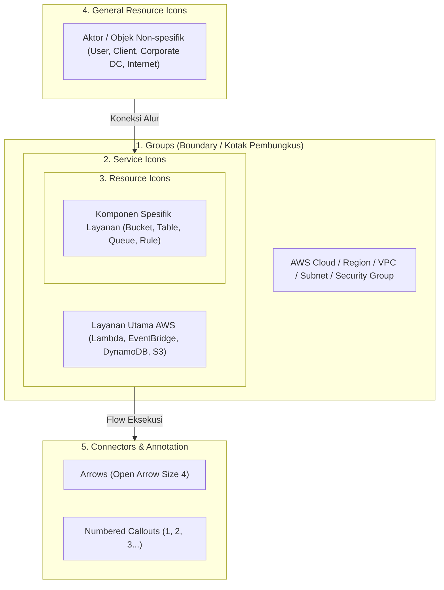
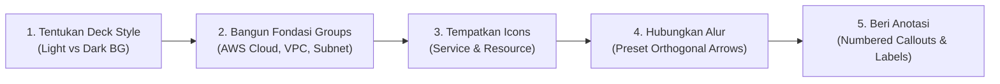

# Panduan Resmi & Standar Penggunaan AWS Architecture Icons
> **Sumber Resmi**: `AWS-Architecture-Icons-Deck_For-Light-BG.pptx` (Deck Resmi AWS Architecture Center — Release `24-2026.07.31`)  
> **Target Penggunaan**: Slide Presentasi Web, Whitepaper, Dokumentasi Teknis, Blog Post, dan Materi Sertifikasi AWS.

---

## 📌 Daftar Isi
1. [Prinsip Dasar & Hierarki Elemen Sistem (System Elements)](#1-prinsip-dasar--hierarki-elemen-sistem-system-elements)
2. [Siklus 5 Langkah Membangun Diagram (Building a Diagram)](#2-siklus-5-langkah-membangun-diagram-building-a-diagram)
3. [Pedoman Berdasarkan Skenario Penggunaan (Use-Case Guidance)](#3-pedoman-berdasarkan-skenario-penggunaan-use-case-guidance)
4. [Aturan Lengkap: Groups (Boundary & Pembungkus)](#4-aturan-lengkap-groups-boundary--pembungkus)
5. [Aturan Lengkap: Icons (Service & Resource Icons)](#5-aturan-lengkap-icons-service--resource-icons)
6. [Aturan Lengkap: Arrows & Connectors (Panah Alur)](#6-aturan-lengkap-arrows--connectors-panah-alur)
7. [Aturan Lengkap: Label & Tipografi (Icon Labels)](#7-aturan-lengkap-label--tipografi-icon-labels)
8. [Aturan Lengkap: Numbered Callouts (Penomoran Urutan)](#8-aturan-lengkap-numbered-callouts-penomoran-urutan)
9. [Aturan Khusus: Layanan Serverless dalam Diagram](#9-aturan-khusus-layanan-serverless-dalam-diagram)
10. [Bedah Contoh Nyata dari Deck Resmi AWS](#10-bedah-contoh-nyata-dari-deck-resmi-aws)
11. [Katalog 26 Kategori Resmi AWS & Kode Warna Group](#11-katalog-26-kategori-resmi-aws--kode-warna-group)
12. [Katalog General Resource Icons](#12-katalog-general-resource-icons)
13. [Checklist Verifikasi Kepatuhan Standar AWS](#13-checklist-verifikasi-kepatuhan-standar-aws)

---

## 1. Prinsip Dasar & Hierarki Elemen Sistem (System Elements)

Diagram arsitektur AWS dirancang sebagai bahasa visual terpadu untuk mengomunikasikan topologi, keamanan, alur data, dan deployment secara terstruktur dan mudah dipahami. Sistem visual resmi AWS terdiri dari 5 komponen utama:



| Elemen Sistem | Definisi & Peran | Ciri Visual Utama |
| :--- | :--- | :--- |
| **Groups** | Menunjukkan batas lingkup arsitektur dan relasi hierarkis antar-komponen. | Kotak bergaris tepi (solid/dashed) dengan label dan icon group di sudut kiri atas. |
| **Service Icons** | Merepresentasikan produk/layanan AWS resmi (e.g. AWS Lambda, Amazon SQS). | Kotak rounded-square dengan warna khas kategori dan simbol layanan di dalamnya. |
| **Resource Icons** | Merepresentasikan entitas atau objek spesifik yang dikelola oleh layanan (e.g., S3 Bucket, DynamoDB Table, EC2 Instance). | Simbol tunggal monokromatis/dua warna tanpa frame luar yang tebal. |
| **General Resource Icons** | Entitas umum yang berlaku lintas layanan atau di luar AWS (User, Client, Internet, Server fisik). | Simbol abu-abu/netral serbaguna yang labelnya dapat dikustomisasi. |
| **Arrows** | Menunjukkan arah aliran data, workflow, atau ketergantungan antar-komponen. | Garis dengan mata panah terbuka (*Open Arrow Size 4*). |
| **Numbered Callouts** | Menandai urutan kronologis eksekusi alur langkah demi langkah. | Lingkaran hitam solid dengan angka putih tebal (*bold white type*). |

---

## 2. Siklus 5 Langkah Membangun Diagram (Building a Diagram)

Saat merancang diagram arsitektur baru, AWS menetapkan alur 5 langkah berurutan:



1. **Pilih Style Deck**:
   - **Light Background** (Latar Putih / Terang): Standar wajib untuk materi berbasis teks, web browser, whitepaper, blog post, dan dokumentasi cetak.
   - **Dark Background** (Latar Gelap / Navy): Digunakan untuk presentasi panggung (*in-person presentation decks*), proyektor ruang gelap, atau display visual berdampak tinggi.
2. **Bangun Fondasi Struktur (Groups)**:
   - Letakkan kotak pembatas terluar terlebih dahulu (`AWS Cloud`), lalu sarangkan (*nest*) container berikutnya: `Region` $\rightarrow$ `Availability Zone` $\rightarrow$ `VPC` $\rightarrow$ `Subnet`.
3. **Tempatkan Service & Resource Icons**:
   - Masukkan icon layanan utama (contoh: *Amazon API Gateway*, *AWS Lambda*), lalu tambahkan resource icon pelengkap jika perlu detail operasional (contoh: *Event*, *Rule*, *Item*).
4. **Hubungkan Alur (Connect the Steps)**:
   - Tarik garis konektor panah resmi (*preset arrows*) untuk memetakan alur request/event dari awal hingga akhir.
5. **Beri Sentuhan Akhir (Final Touches)**:
   - Pasang *Numbered Callouts* jika diagram mendeskripsikan urutan transaksi multi-langkah (e.g., *1. Request*, *2. Validasi*, *3. Publish Event*).

---

## 3. Pedoman Berdasarkan Skenario Penggunaan (Use-Case Guidance)

### A. Skenario Umum (Slide Presentasi & Web)
- Gunakan icon SVG asli untuk menjaga ketajaman rendering.
- Boleh menyesuaikan skala icon untuk kebutuhan slide presentasi umum, **tetapi wajib menahan tombol `Shift`** saat me-resize agar rasio aspek 1:1 tidak terdistorsi.

### B. Skenario Format Vertikal / Portrait (Word Document & Blog Post)
Bila diagram harus disisipkan ke dalam dokumen berorientasi portrait (seperti Microsoft Word atau artikel teknis vertikal):
- **Slide Setup**: Buka PowerPoint $\rightarrow$ *File* $\rightarrow$ *Page Setup*, ubah ukuran slide menjadi **Lebar 6.5 inci** dan **Tinggi 8.75 inci** (*portrait orientation*).
- **Background**: Wajib menggunakan background putih solid.
- **Exporting**: Setelah diagram selesai, *Group* semua elemen $\rightarrow$ *Copy* $\rightarrow$ di Microsoft Word klik *Paste Dropdown* $\rightarrow$ pilih **Paste as Picture**. Cara ini mencegah pergeseran teks dan garis saat dokumen dibuka di perangkat lain.

### C. Skenario Materi Pelatihan & Sertifikasi (Training & Certification)
AWS menetapkan aturan aksesibilitas dan kepatuhan visual yang sangat ketat untuk materi ujian dan pelatihan resmi:
- **Background**: Hanya boleh pada background **putih** (`#FFFFFF`).
- **Ukuran & Warna Tipografi**: Seluruh teks wajib menggunakan font berukuran **16pt** dan berwarna **hitam solid** (`#000000`).
- **Ukuran Icon**: Seluruh icon menggunakan ukuran tetap bawaan (*fixed predefined size*), **dilarang di-resize sama sekali**.
- **Warna Icon**: Dilarang mengubah saturasi, hue, atau warna icon (seluruh palet sudah lolos uji kontras WCAG).
- **Ketebalan Garis (Line Weight)**: Seluruh garis dan panah wajib berbobot **2pt**, dengan warna resmi yang teruji aksesibilitasnya.

---

## 4. Aturan Lengkap: Groups (Boundary & Pembungkus)

Group merepresentasikan batas logis, jaringan, atau keamanan arsitektur.

```
┌── [Icon] Virtual private cloud (VPC) ──────────────────────────────────┐
│                                                                        │
│   ┌── [Icon] Public subnet ────────────────────────────────────────┐   │
│   │                                                                │   │
│   │   [Service Icon] Amazon EC2        [Resource Icon] Instance   │   │
│   │                                                                │   │
│   └────────────────────────────────────────────────────────────────┘   │
│                                                                        │
└────────────────────────────────────────────────────────────────────────┘
```

### A. Aturan Ukuran, Resizing & Nesting
- **Titik Tarik Resizing**: Mengubah ukuran kotak group hanya boleh dilakukan melalui **sudut kanan bawah (bottom-right corner)** agar posisi icon dan label group di sudut kiri atas tetap terkunci.
- **Buffer Bersarang (Nested Groups)**: Ketika satu group berada di dalam group lain (misalnya Subnet di dalam VPC), group bagian dalam **wajib memiliki jarak penyangga (buffer) minimal 0.05 inci di semua sisi** terhadap batas luar.
- **Icon Group**: Icon penanda group di sudut kiri atas **tidak boleh di-resize** secara terpisah.

### B. Pengecualian Merek Regional (Regional Trademark Rule)
> [!IMPORTANT]
> Di Region AWS tertentu (khususnya **AWS China Regions**), AWS tidak memegang hak merek dagang untuk teks huruf **"AWS"**.
> - Gunakan group dengan logo teks `"AWS Cloud"` untuk seluruh Region Global.
> - Di Region China atau materi yang ditujukan khusus untuk yurisdiksi tersebut, gunakan varian group dengan **simbol ikon awan tanpa teks "AWS"**.

### C. Katalog 18 Preset Groups Bawaan Resmi

| Nama Preset Group | Warna Garis (Hex) | Tipe Garis | Fungsi Arsitektural |
| :--- | :--- | :--- | :--- |
| **AWS Cloud** | `#232F3E` / Dark Navy | Solid | Batas akun/lingkungan AWS Cloud terluar |
| **Region** | `#00A4A6` / Teal | Dashed (`sysDash`) | Batas geografis AWS Region |
| **Availability Zone (AZ)** | `#00A4A6` / Teal | Dashed (`dash`) | Batas data center Availability Zone |
| **Virtual Private Cloud (VPC)** | `#8C4FFF` / Purple | Solid | Batas isolasi jaringan privat virtual |
| **Public Subnet** | `#7AA116` / Green | Solid | Subnet publik yang memiliki rute langsung ke IGW |
| **Private Subnet** | `#00A4A6` / Teal | Solid | Subnet privat tanpa rute publik langsung |
| **Security Group** | `#DD344C` / Red | Solid | Firewall virtual tingkat instance |
| **Auto Scaling Group** | `#ED7100` / Orange | Dashed (`dash`) | Batas elastisitas kelompok instance komputasi |
| **Corporate Data Center** | `#7D8998` / Gray | Solid | Lingkungan on-premises klien |
| **Server Contents** | `#7D8998` / Gray | Solid | Batas isi server fisik on-premises |
| **EC2 Instance Contents** | `#ED7100` / Orange | Solid | Batas komponen internal di dalam sebuah instance EC2 |
| **Spot Fleet** | `#ED7100` / Orange | Solid | Kumpulan instance cadangan Spot |
| **AWS Account** | `#E7157B` / Pink Magenta | Solid | Batas isolasi multi-account AWS Organizations |
| **AWS Step Functions Workflow** | `#E7157B` / Pink Magenta | Solid | Lingkup alur state machine Step Functions |
| **Elastic Beanstalk Container** | `#ED7100` / Orange | Solid | Lingkup bundle runtime Elastic Beanstalk |
| **AWS IoT Greengrass Deployment** | `#7AA116` / Green | Solid | Batas penyebaran paket IoT edge |
| **AWS IoT Greengrass** | `#7AA116` / Green | Solid | Lingkungan runtime edge IoT |
| **Generic Group** | `#7D8998` / Gray | Solid & Dashed | Group serbaguna untuk konsep kustom |

### D. Aturan Membuat Custom Group untuk Suatu Layanan
Jika memerlukan group khusus yang melambangkan layanan tertentu (misalnya *Amazon EventBridge Event Bus Group* atau *DynamoDB Table Group*), gunakan aturan 7 rumpun warna resmi berikut:

| Warna Tepi | Kode Hex | Kategori Layanan yang Menggunakan Warna Ini |
| :--- | :--- | :--- |
| **Purple** | `#8C4FFF` | Analytics, Games, Networking & Content Delivery, Serverless |
| **Pink / Magenta** | `#E7157B` | Application Integration, Management Tools, Multicloud & Hybrid |
| **Green** | `#7AA116` | Cloud Financial Management, Internet of Things, Storage |
| **Teal** | `#01A88D` | Artificial Intelligence, End User Computing, Migration & Modernization |
| **Orange** | `#ED7100` | Blockchain, Compute, Containers, Media Services, Quantum Technologies |
| **Red** | `#DD344C` | Business Applications, Customer Experience, Front-End Web & Mobile, Security & Identity |
| **Violet** | `#C925D1` | Customer Enablement, Databases, Developer Tools, Satellite |

**Langkah Kustomisasi Resmi:**
1. Pilih template group dengan warna kategori yang sesuai dari tabel di atas.
2. Klik kanan pada icon kotak di sudut kiri atas group $\rightarrow$ pilih **Change Graphic** $\rightarrow$ **From a File**.
3. Arahkan ke folder paket aset: `Architecture-Service-Icons` $\rightarrow$ folder kategori $\rightarrow$ folder **`Arch_32`**.
4. Pilih file icon berformat **`.svg`**.  
   *(PERINGATAN: Dilarang memilih format PNG karena resolusi akan pecah/terdegradasi saat group diperbesar).*
5. Ubah teks label nama group sesuai kebutuhan arsitektur.

### E. DOs and DON'Ts Groups
- ✅ **DO**: Gunakan `Generic Group` jika tidak ada preset yang cocok.
- ✅ **DO**: Selalu berikan jarak minimal 0.05" antar-kotak bertingkat (*nested*).
- ❌ **DON'T**: Membuat kotak group menggunakan icon non-resmi atau icon buatan sendiri.
- ❌ **DON'T**: Me-resize icon penanda group di sudut kiri atas secara terpisah.

---

## 5. Aturan Lengkap: Icons (Service & Resource Icons)

Icon arsitektur AWS dibagi menjadi dua tipe: **Service Icons** (layanan utama) dan **Resource Icons** (komponen internal).

```
   [ Service Icon ]            [ Resource Icon ]
   ┌─────────────┐
   │    ▲ ▲      │                 (●)
   │   ◄   ►     │              ┌───────┐
   │    ▼ ▼      │              │ S3    │
   └─────────────┘              │Bucket │
     AWS Lambda                 └───────┘
                               S3 Bucket
```

### A. Panduan Dimensi & Scaling
- **Dalam Diagram Arsitektur**: Icon **wajib digunakan pada ukuran bawaan (predefined size)**. Dilarang memperbesar atau memperkecil icon semaunya di kanvas diagram arsitektur untuk menjaga keterbacaan yang seragam.
- **Dalam Slide Presentasi**: Icon boleh diskalakan jika berfungsi sebagai ilustrasi judul/point, **dengan syarat mutlak menahan tombol `Shift`** saat dragging sudut icon.
- **Format Berkas**: Selalu gunakan vektor `.svg` di web/aplikasi presentasi modern agar tetap tajam pada resolusi 4K.

### B. DOs and DON'Ts Icons
- ✅ **DO**: Pertahankan ukuran baku, format, dan palet warna asli icon dalam diagram.
- ✅ **DO**: Tahan tombol `Shift` saat melakukan resizing pada materi presentasi.
- ❌ **DON'T**: Me-crop (*cropping*) bagian mana pun dari icon.
- ❌ **DON'T**: Memutar (*rotate*) atau membalik (*flip horizontal/vertical*) icon.
- ❌ **DON'T**: Mengubah bentuk geometris icon (misalnya mengubah sudut melengkung menjadi runcing).
- ❌ **DON'T**: Mengganti warna icon (misalnya mengubah warna orange Lambda menjadi biru).

---

## 6. Aturan Lengkap: Arrows & Connectors (Panah Alur)

Panah menghubungkan komponen dan mendeskripsikan arus request, payload data, sinkronisasi, atau ketergantungan.

```
Benar (Orthogonal / Right-Angle):
[ API Gateway ] ───────┐
                       ▼
                 [ AWS Lambda ] ──────► [ DynamoDB ]

Salah (Diagonal sembarangan / Melengkung bebas):
[ API Gateway ] ＼
                   ＼
                     ▼ [ DynamoDB ]
```

### A. Format Kepala & Bobot Panah
- **Gaya Kepala Panah**: Wajib menggunakan **Open Arrow** (*bukan panah segitiga penuh/solid*).
- **Ukuran Kepala Panah**: **Size 4**.
- **Bobot Garis**: Standar 1.25pt - 1.5pt (atau 2pt khusus untuk standar *Training & Certification*).

### B. Aturan Penarikan Garis (Routing)
- **Siku-Siku 90 Derajat (Elbow / Right Angle)**: Selalu utamakan garis lurus horizontal, vertikal, dan belokan siku 90 derajat (*Elbow Connector*).
- **Garis Diagonal**: Hanya diperbolehkan jika layout arsitektur sangat padat dan penarikan garis siku-siku terbukti mustahil tanpa menabrak icon lain.
- **Edit Sudut**: Selalu tahan tombol `Shift` saat mengatur panjang konektor agar garis tidak miring secara tidak disengaja.

### C. Variasi Konektor yang Diizinkan

| Jenis Konektor | Contoh Penggunaan |
| :--- | :--- |
| **Garis Lurus Satu Arah (Solid Arrow)** | Request sinkron atau pengiriman event searah (e.g., API GW $\rightarrow$ Lambda). |
| **Garis Siku Satu Arah (Elbow Arrow)** | Alur navigasi antar-tingkat arsitektur tanpa memotong icon lain. |
| **Panah Dua Arah (Bidirectional)** | Komunikasi timbal balik dua arah / sinkronisasi handshake (e.g., Client $\leftrightarrow$ Cognito). |
| **Garis Putus-putus (Dashed Arrow)** | Aliran data asynchronous, polling, atau notifikasi latar belakang. |
| **Garis Tanpa Panah (Plain Solid Line)** | Keterkaitan pasif atau asosiasi resource (e.g., Subnet terhubung ke Route Table). |

### D. DOs and DON'Ts Arrows
- ✅ **DO**: Gunakan preset connectors yang disediakan di section *Elements* deck resmi.
- ✅ **DO**: Gunakan garis lurus dan belokan siku 90° sesering mungkin.
- ❌ **DON'T**: Menggunakan gaya panah melengkung (*curved splines*) acak atau panah artistik non-standar.
- ❌ **DON'T**: Menggunakan panah bertipe *Closed Solid Arrow* atau *Stealth Arrow*.

---

## 7. Aturan Lengkap: Label & Tipografi (Icon Labels)

Label teks memberikan identitas dan parameter teknis pada setiap icon.

```
       [ Icon ]                  [ Icon ]
      AWS Lambda                Amazon S3
      (Maksimal 2 baris)      SSH key bucket
```

### A. Tipografi & Tata Letak
- **Jenis Huruf**: **Arial** ukuran **12pt** (atau **16pt hitam** khusus materi *Training & Certification*).
- **Pemisahan Fisik**: Icon dan kotak teks label dibuat terpisah (dua objek berbeda) untuk memudahkan penyesuaian posisi, multi-bahasa, atau penyingkatan.

### B. Aturan Pemenggalan Baris (Name Wrapping & Line Breaks)
- **Batas Maksimal**: Nama layanan **maksimal terdiri dari 2 baris**.
- **Larangan Tanda Hubung Pemenggal Kata**: **Dilarang memenggal suku kata di tengah kata** (*mid-word break*).
  - ❌ *Salah*: `AWS Elastic Bean-` (baris 1) dan `stalk` (baris 2).
  - ✅ *Benar*: `AWS Elastic` (baris 1) dan `Beanstalk` (baris 2).
- **Aturan Nama Prefix "AWS" atau "Amazon"**: Kata "AWS" atau "Amazon" **wajib berada di baris yang sama dengan kata pertama nama produk**. Tidak boleh membiarkan kata "AWS" sendirian di baris pertama!
  - ❌ *Salah*: Baris 1: `AWS`, Baris 2: `Elastic Beanstalk`.
  - ✅ *Benar*: Baris 1: `AWS Elastic Beanstalk` (jika muat) atau Baris 1: `AWS Elastic`, Baris 2: `Beanstalk`.

### C. Aturan Penggunaan Singkatan (Short Forms)
- Singkatan nama layanan (misalnya `Amazon EC2` alih-alih `Amazon Elastic Compute Cloud`, atau `Amazon SQS` alih-alih `Amazon Simple Queue Service`) diperbolehkan untuk menghemat ruang jika layanan muncul berulang kali.
- **Syarat Mutlak**: Nama lengkap layanan **wajib disebutkan minimal satu kali terlebih dahulu** di dalam dokumen/diagram sebelum bentuk singkatan digunakan.
- **Larangan Singkatan Ambigu**: Dilarang menggunakan akronim yang sama untuk dua layanan berbeda dalam satu diagram (misalnya singkatan `ELB` tidak boleh merujuk ke *Elastic Beanstalk* dan *Elastic Load Balancing* sekaligus).

### D. Aturan Khusus EC2 Instance
- Khusus untuk icon resource **EC2 Instance**, diagram wajib mencantumkan label tipe instance spesifik di bawahnya:
  - Contoh yang benar: `M5n instance`, `C5.large instance`, `High Memory instance`.

### E. DOs and DON'Ts Labels
- ✅ **DO**: Potong baris setelah kata kedua nama layanan jika teks terlalu panjang.
- ✅ **DO**: Kustomisasi label untuk *General Icons* sesuai konteks bisnis (e.g., icon `User` diberi label `Mobile Driver`, `Customer`, atau `Admin`).
- ❌ **DON'T**: Memenggal suku kata dengan tanda strip di akhir baris.
- ❌ **DON'T**: Menggunakan singkatan tanpa menyebut nama panjangnya terlebih dahulu.

---

## 8. Aturan Lengkap: Numbered Callouts (Penomoran Urutan)

Numbered callouts digunakan untuk memandu pembaca memahami alur eksekusi proses multi-tahap.

```
               ┌───────────────────────────────┐
               │ 1. Client kirim POST /order   │
               │ 2. Lambda simpan ke DynamoDB  │
               │ 3. EventBridge emit event     │
               └───────────────────────────────┘

  [ Client ] ──( 1 )──► [ API GW ] ──( 2 )──► [ Lambda ] ──( 3 )──► [ EventBridge ]
```

### A. Desain & Ukuran Callout
- **Bentuk & Warna**: Lingkaran hitam solid (`#000000`) dengan angka putih tebal (*bold white*). Kontras tinggi ini memastikan nomor tetap terbaca jelas di atas kotak group berwarna apa pun.
- **Dua Pilihan Ukuran Resmi**:
  1. **Large Callouts**: Digunakan pada diagram sederhana dengan ruang kanvas yang lega.
  2. **Small Callouts**: Digunakan pada diagram kompleks/padat agar tidak menutupi nama komponen.

### B. Aturan Penataan Linear (Ordering Principles)
- Penomoran wajib bergerak secara teratur dan logis mengikuti salah satu dari 3 orientasi:
  1. **Kiri ke Kanan** (*Left-to-Right*)
  2. **Atas ke Bawah** (*Top-to-Bottom*)
  3. **Searah Jarum Jam** (*Clockwise*)
- Letakkan nomor callout secara konsisten (misalnya selalu di atas panah atau tepat di samping kiri icon terkait).

### C. DOs and DON'Ts Numbered Callouts
- ✅ **DO**: Gunakan callout dengan ukuran, warna, dan font resmi bawaan deck.
- ✅ **DO**: Susun nomor berurutan dari 1 sampai N tanpa melompati angka.
- ❌ **DON'T**: **Mencampur ukuran Large dan Small dalam satu diagram yang sama**.
- ❌ **DON'T**: Mengubah warna latar hitam lingkaran atau mengganti warna teks angka.
- ❌ **DON'T**: Menggunakan huruf (A, B, C) atau simbol grafis lain di dalam lingkaran callout.
- ❌ **DON'T**: Menarik atau memipihkan (*stretch*) bentuk lingkaran callout menjadi lonjong.

---

## 9. Aturan Khusus: Layanan Serverless dalam Diagram

> [!NOTE]
> Berdasarkan catatan resmi AWS Architecture Center pada **Slide 147**:
> 
> *"Serverless is a way to describe the services that enable you to build and run applications without thinking about servers. AWS has serverless services for all layers of your stack... When it comes to building an architecture diagram, **it’s more intuitive to use a functional categorization**."*

### Prinsip Klasifikasi Fungsional Serverless:
Meskipun materi pemasaran AWS sering mengelompokkan layanan seperti Lambda, Step Functions, DynamoDB, dan EventBridge ke dalam satu payung *"Serverless"*, aturan resmi perancangan diagram arsitektur AWS menetapkan:

1. **Gunakan Kategori Fungsional Asli**:
   - **AWS Lambda** $\rightarrow$ Kategori **Compute**
   - **Amazon EventBridge, SQS, SNS, Step Functions** $\rightarrow$ Kategori **Application Integration**
   - **Amazon DynamoDB** $\rightarrow$ Kategori **Databases**
   - **Amazon S3** $\rightarrow$ Kategori **Storage**
   - **Amazon API Gateway** $\rightarrow$ Kategori **Networking & Content Delivery**
   - **Amazon Cognito** $\rightarrow$ Kategori **Security, Identity, & Compliance**
2. **Peran Icon Kategori Serverless**:
   - Icon kategori Serverless **hanya digunakan sebagai penanda umum** untuk merepresentasikan keseluruhan solusi/aplikasi bertema serverless, bukan sebagai icon pengganti fungsi komputasi atau database.

---

## 10. Bedah Contoh Nyata dari Deck Resmi AWS

Deck resmi menyertakan dua contoh arsitektur nyata di **Slide 20 dan Slide 21** yang menjadi acuan implementasi:

### Contoh 1: Git to S3 Webhooks (Event-Driven Pattern) — Slide 20
Diagram ini mendemonstrasikan integrasi sistem eksternal dengan lingkungan serverless AWS:

```
[ Git users ] ──► (Git push) ──► [ Third-party Git repository ]
                                              │
                                         (Git webhook)
                                              ▼
┌── AWS Cloud ────────────────────────────────────────────────────────┐
│                                                                     │
│   [ Service ] AWS Lambda                                            │
│          │                                                          │
│          ├──────────────► [ Resource ] AWS KMS key                  │
│          │                                                          │
│          ├──────────────► [ Resource ] Amazon S3 SSH key bucket     │
│          │                                                          │
│          └──────────────► [ Resource ] Amazon S3 output bucket      │
│                                                                     │
└─────────────────────────────────────────────────────────────────────┘
```

**Poin-Poin Standar yang Diterapkan:**
- Entitas di luar cloud (`Git users`, `Third-party Git repository`) berada di luar batas kotak `AWS Cloud`.
- Alur webhook dari luar menembus masuk ke dalam kotak `AWS Cloud` langsung menuju fungsi `AWS Lambda`.
- Penggunaan **Resource Icons** spesifik di samping Service Icon: `AWS KMS key` merepresentasikan kunci enkripsi, dan dua buah `Amazon S3 bucket` merepresentasikan bucket SSH dan bucket output secara terpisah.

---

### Contoh 2: Chef Automate Architecture on AWS (Network Topology & Callouts) — Slide 21
Diagram ini mendemonstrasikan nesting boundary jaringan, CIDR block, dan penggunaan Numbered Callouts:

```
┌── AWS Cloud ───────────────────────────────────────────────────────────────────────────────────────┐
│                                                                                                    │
│   ┌── Region ──────────────────────────────────────────────────────────────────────────────────┐   │
│   │                                                                                            │   │
│   │   ┌── Availability Zone ───────────────────────────────────────────────────────────────┐   │   │
│   │   │                                                                                    │   │   │
│   │   │   ┌── Virtual private cloud (VPC) [10.0.0.0/16] ───────────────────────────────┐   │   │   │
│   │   │   │   [ Internet gateway ]                                                     │   │   │   │
│   │   │   │                                                                            │   │   │   │
│   │   │   │   ┌── Public subnet [10.0.0.0/19] ─────────────────────────────────────┐   │   │   │   │
│   │   │   │   │                                                                    │   │   │   │   │
│   │   │   │   │   [ Service ] Chef Automate                                        │   │   │   │   │
│   │   │   │   │                                                                    │   │   │   │   │
│   │   │   │   │   ( 1 ) Chef Knife uploads cookbooks                               │   │   │   │   │
│   │   │   │   │   [ General Icon ] Chef workstation (local Chef repo)              │   │   │   │   │
│   │   │   │   │                                                                    │   │   │   │   │
│   │   │   │   │   ( 2 ) Knife bootstraps and communicates with nodes               │   │   │   │   │
│   │   │   │   │   ( 3 ) Chef client processes run list                             │   │   │   │   │
│   │   │   │   │   [ General Icon ] Chef node                                       │   │   │   │   │
│   │   │   │   │                                                                    │   │   │   │   │
│   │   │   │   └────────────────────────────────────────────────────────────────────┘   │   │   │   │
│   │   │   └────────────────────────────────────────────────────────────────────────────┘   │   │   │   │
│   │   └────────────────────────────────────────────────────────────────────────────────────┘   │   │   │   │
│   └────────────────────────────────────────────────────────────────────────────────────────────┘   │   │
└────────────────────────────────────────────────────────────────────────────────────────────────────┘
```

**Poin-Poin Standar yang Diterapkan:**
- **Nesting 4 Lapis yang Disiplin**: `AWS Cloud` $\rightarrow$ `Region` $\rightarrow$ `Availability Zone` $\rightarrow$ `VPC` $\rightarrow$ `Public Subnet`.
- **Informasi CIDR Block**: Alokasi subnet IP (`10.0.0.0/16` dan `10.0.0.0/19`) ditempatkan rapi di bawah label group.
- **Numbered Callouts & Step Legend**: Callout nomor `1`, `2`, dan `3` ditempatkan pada panah alur, sementara teks penjelas alur (*"1. Chef Knife uploads...", "2. Knife bootstraps...", "3. Chef client processes..."*) diletakkan di header atas diagram.

---

## 11. Katalog 26 Kategori Resmi AWS & Kode Warna Group

Berikut daftar lengkap seluruh 26 kategori resmi AWS di dalam deck presentasi beserta nomor slide, rumpun warna group, dan contoh layanan serta resource icons:

| No | Kategori Resmi AWS | Slide PPTX | Warna Group | Kode Hex | Contoh Service & Resource Icons Populer |
| :---: | :--- | :---: | :---: | :---: | :--- |
| **1** | **Analytics** | 30–36 | Purple | `#8C4FFF` | Amazon Athena, EMR, Kinesis Data Streams, OpenSearch, AWS Glue (Crawler, Data Catalog), Amazon Redshift, MSK, DataZone. |
| **2** | **Application Integration** | 37–40 | Pink / Magenta | `#E7157B` | Amazon EventBridge (Event, Rule, EventBus), SNS (Topic, Email/HTTP notification), SQS (Queue, Message), Step Functions, AppSync, Amazon MQ. |
| **3** | **Artificial Intelligence (AI)** | 41–51 | Teal | `#01A88D` | Amazon Bedrock, SageMaker (Notebook, Model, Train, Canvas), Rekognition, Polly, Transcribe, Lex, Comprehend, Textract, Kendra. |
| **4** | **Blockchain** | 52–53 | Orange | `#ED7100` | Amazon Managed Blockchain (Network, Node). |
| **5** | **Business Applications** | 54–58 | Red | `#DD344C` | Amazon Connect, SES (Email), Chime SDK, Pinpoint (Journey), WorkMail, AWS Supply Chain, AppFabric. |
| **6** | **Cloud Financial Management** | 59–61 | Green | `#7AA116` | AWS Cost Explorer, Budgets, Cost and Usage Report, Savings Plans, Billing Conductor, **AWS FinOps Agent** *(Release 2026)*. |
| **7** | **Compute** | 62–69 | Orange | `#ED7100` | Amazon EC2 (AMI, Auto Scaling, Instance types), AWS Lambda, Elastic Beanstalk, App Runner, Batch, Lightsail, Outposts. |
| **8** | **Containers** | 70–72 | Orange | `#ED7100` | Amazon ECS (Task, Container, Service Connect), Amazon EKS (EKS on Outposts, Anywhere), Amazon ECR (Registry, Image), AWS Fargate, ROSA. |
| **9** | **Customer Enablement** | 73–75 | Violet | `#C925D1` | AWS Support, Professional Services, Managed Services, Training & Certification, AWS Activate, AWS re:Post. |
| **10** | **Customer Experience** | 76–77 | Red | `#DD344C` | Amazon Connect (Contact Center platform). |
| **11** | **Databases** | 78–83 | Violet | `#C925D1` | Amazon Aurora, DynamoDB (Table, Item, Stream, DAX, GSI), RDS, DocumentDB, ElastiCache, MemoryDB, Neptune, Timestream, Keyspaces. |
| **12** | **Developer Tools** | 84–89 | Violet | `#C925D1` | AWS CodePipeline, CodeBuild, CodeDeploy, CodeCommit, CodeArtifact, Cloud9, CLI, SDKs, Cloud Development Kit (CDK), AWS X-Ray. |
| **13** | **End User Computing** | 90–91 | Teal | `#01A88D` | Amazon WorkSpaces, AppStream 2.0. |
| **14** | **Front-End Web & Mobile** | 92–93 | Red | `#DD344C` | AWS Amplify (Amplify Studio), Device Farm, Amazon Location Service (Map, Track, Geofence, Route). |
| **15** | **Games** | 94–95 | Purple | `#8C4FFF` | Amazon GameLift (Servers, Streams), Open 3D Engine. |
| **16** | **Internet of Things (IoT)** | 96–101 | Green | `#7AA116` | AWS IoT Core, IoT Greengrass, IoT Device Defender, IoT Device Management, IoT TwinMaker, IoT SiteWise, FreeRTOS. |
| **17** | **Management Tools** | 102–112 | Pink / Magenta | `#E7157B` | Amazon CloudWatch (Logs, Metrics, Alarms, Synthetics), AWS CloudFormation (Stack, Change Set), CloudTrail, Config, Systems Manager, Auto Scaling. |
| **18** | **Media Services** | 113–119 | Orange | `#ED7100` | AWS Elemental MediaConvert, MediaLive, MediaPackage, MediaConnect, Interactive Video Service (IVS), Thinkbox Deadline. |
| **19** | **Migration & Modernization** | 120–123 | Teal | `#01A88D` | AWS Application Migration Service (MGN), Database Migration Service (DMS), DataSync, Transfer Family (SFTP/FTPS), Mainframe Modernization. |
| **20** | **Multicloud & Hybrid** | 124–125 | Pink / Magenta | `#E7157B` | AWS Outposts, AWS Wavelength, AWS Local Zones, VMware Cloud on AWS, EKS Anywhere. |
| **21** | **Networking & Content Delivery** | 126–132 | Purple | `#8C4FFF` | Amazon VPC (Subnet, NAT Gateway, IGW, Peering, Endpoints), CloudFront (Edge, Functions), Route 53 (Hosted Zone), API Gateway, Transit Gateway, Elastic Load Balancing (ALB/NLB). |
| **22** | **Quantum Technologies** | 133–134 | Orange | `#ED7100` | Amazon Braket (QPU, Chip, Chandelier, Simulator, Tensor network). |
| **23** | **Satellite** | 135–136 | Violet | `#C925D1` | AWS Ground Station (Antenna, Uplink/Downlink). |
| **24** | **Security, Identity, & Compliance** | 137–145 | Red | `#DD344C` | AWS IAM (Role, Policy, Identity Center), Cognito, KMS (CMK key), Secrets Manager, Shield, WAF (Rule), GuardDuty, Security Hub, Macie, Inspector. |
| **25** | **Serverless** | 146–147 | Purple | `#8C4FFF` | Serverless Category Badge & Solution Icon *(Gunakan kategori fungsional asli untuk service spesifik)*. |
| **26** | **Storage** | 148–156 | Green | `#7AA116` | Amazon S3 (Bucket, Standard, Glacier, Intelligent-Tiering), EBS (Volume, Snapshot), EFS, FSx for Lustre, Backup (Vault, Plan), Snow Family. |

---

## 12. Katalog General Resource Icons

Di samping icon layanan resmi, AWS menyediakan koleksi icon generik netral di **Slide 28 dan Slide 29** untuk memodelkan aset infrastruktur lokal, pengguna, dan interaksi sistem umum:

```
┌─────────────────────────────────────────────────────────────────────────────────┐
│                      GENERAL RESOURCE ICONS CATALOGUE                           │
├──────────────────────┬──────────────────────────┬───────────────────────────────┤
│ Klien & Aktor        │ Infrastruktur & Jaringan │ Data & Format Berkas          │
├──────────────────────┼──────────────────────────┼───────────────────────────────┤
│ • User               │ • Internet               │ • Database (Generic Cylinder) │
│ • Users (Kelompok)   │ • Internet (Alt 1 & 2)   │ • Data stream                 │
│ • Authenticated user │ • Globe                  │ • Data table                  │
│ • Client             │ • Office building        │ • Document / Documents        │
│ • Mobile client      │ • Corporate data center  │ • Folder / Folders            │
│ • Forums             │ • Server / Servers       │ • Logs                        │
│ • Chat               │ • Tape storage           │ • JSON script                 │
│                      │ • Disk / Cold storage    │ • Source code                 │
├──────────────────────┼──────────────────────────┼───────────────────────────────┤
│ Keamanan & Identitas │ Developer & Aplikasi     │ Observability & Operasional   │
├──────────────────────┼──────────────────────────┼───────────────────────────────┤
│ • SAML token         │ • Generic application    │ • Metrics, Data visualization │
│ • SSL padlock        │ • Git repository         │ • AWS Management Console      │
│ • Credentials / Key  │ • Programming language   │ • Magnifying glass (Search)   │
│ • Shield             │ • Multimedia             │ • Alert (Tanda seru)          │
│ • Firewall           │ • SDK / Toolkit          │ • Gear (Setting) / Question   │
│                      │ • Email                  │ • Recover (Panah putar)       │
└──────────────────────┴──────────────────────────┴───────────────────────────────┘
```

> [!TIP]
> Label pada *General Resource Icons* bersifat **sepenuhnya fleksibel**. Sebagai contoh:
> - Icon `User` dapat diganti labelnya menjadi `Admin`, `Customer`, `Driver`, atau `Operator`.
> - Icon `Generic application` dapat dinamai `Legacy Monolith`, `ERP Core`, atau `Payment Gateway Third-Party`.

---

## 13. Checklist Verifikasi Kepatuhan Standar AWS

Sebelum diagram arsitektur dipublikasikan atau diintegrasikan ke dalam materi slide, lakukan verifikasi mandiri menggunakan checklist berikut:

- [ ] **Latar Belakang Sesuai**: Menggunakan background terang (*Light BG* / putih) untuk web/materi bacaan, atau background gelap (*Dark BG*) untuk panggung slide presentasi.
- [ ] **Boundary Bertingkat Rapi**: Kotak `AWS Cloud` membungkus seluruh resource AWS; batas eksternal (User / On-prem / Third-party) berada di luar kotak `AWS Cloud`.
- [ ] **Jarak Bersarang (Nesting Buffer)**: Seluruh kotak di dalam kotak lain memiliki ruang napas minimal 0.05" di semua sisi.
- [ ] **Icon Tidak Terdistorsi**: Rasio icon 1:1 terjaga sempurna, tidak ada icon yang terpotong (*cropped*), diputar (*rotated*), atau dibalik (*flipped*).
- [ ] **Warna Group Resmi**: Jika membuat custom group, warna garis border menggunakan salah satu dari 7 warna kategori resmi AWS.
- [ ] **Kepala Panah Sesuai**: Seluruh konektor panah menggunakan format **Open Arrow Size 4** dengan garis siku 90 derajat (*Elbow*).
- [ ] **Penamaan Layanan Teratur**: Teks nama layanan maksimal 2 baris, kata `"AWS"` atau `"Amazon"` tidak sendirian di baris pertama, dan tidak ada pemenggalan kata bersambung (*no mid-word hyphenation*).
- [ ] **Kepatuhan Serverless**: Layanan serverless ditempatkan sesuai kategori fungsionalnya (Lambda di Compute, SQS/SNS/EventBridge di App Integration, DynamoDB di Database).
- [ ] **Numbered Callouts Konsisten**: Jika menggunakan nomor urutan, seluruh nomor memiliki ukuran yang sama (*tidak mencampur Large dan Small*) dan alur urutan bergerak secara teratur (L-to-R atau clockwise).
